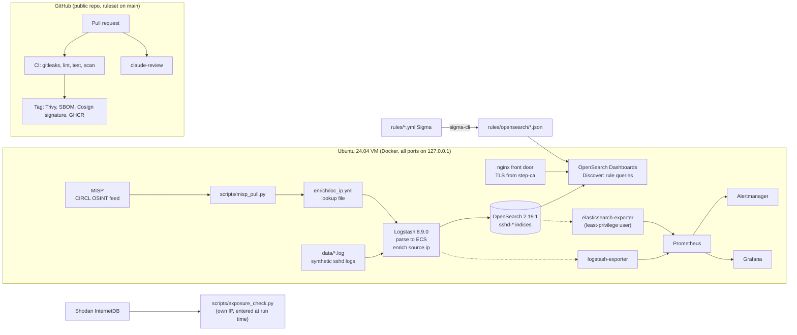

# SSH brute-force detection with threat-intelligence enrichment

> ULBS · Cybersecurity master's · Labs Module 4 · Owner: i0ana404 · 2026-11-20
> Repository: `i0ana404/R_D-Lab` · Release: v0.4.1 · Risk register: [RISK-REGISTER.md](../RISK-REGISTER.md) · Evidence: [docs/evidence/](evidence/README.md)

## 1. Summary

An SSH bastion host is attacked all the time by bots guessing passwords. Without detection the attack is invisible.
This project builds a small, reproducible detection stack around that problem:

- sshd authentication logs are parsed into ECS fields by Logstash and stored in OpenSearch;
- detections are written as Sigma rules, tested against positive, negative and near-miss samples, and converted to OpenSearch queries;
- source IPs are checked against a MISP threat-intelligence feed; a match tags the event and raises its risk score;
- Prometheus, Alertmanager and Grafana alert when the detection pipeline itself stops;
- the owner's own internet exposure is checked with Shodan InternetDB.

It is built with an AI coding agent (Claude Code) under explicit rules, in a protected GitHub repository where every change passes automated checks and an automated AI review. Every control is traced to a row of the risk register, and every row that says *Implemented* or *Accepted* has evidence.

## 2. Scope

| In scope | Out of scope |
|---|---|
| Detecting password guessing, password spraying and successful root password logins in sshd logs | Blocking IPs or any active response |
| Enriching events with MISP indicators | Anything exposed to the internet: every port is bound to 127.0.0.1 |
| Monitoring the pipeline itself | Real user data: only synthetic logs created by the owner |
| Securing the engineering workflow (AI agent, CI, supply chain, secrets) | Production hardening beyond the lab VM |

## 3. Architecture

| Component | Version / pin | Notes |
|---|---|---|
| nginx front door | 1.30.7-alpine-slim, by digest | Built from `nginx/Dockerfile`; certificate from the internal step-ca |
| OpenSearch, Dashboards | 2.19.1, by digest | Demo security plugin |
| Logstash | `logstash-oss-with-opensearch-output-plugin:8.9.0`, by digest | Newest published tag (2023); known residual in R-13 |
| Sigma | sigma-cli 3.1.0, pySigma-backend-opensearch 2.0.3 | sigma-cli 4 is incompatible with the backend (closed PR #19) |
| MISP | misp-docker, images by digest | TLS from the internal step-ca |
| Monitoring | Prometheus v3.16.0, Alertmanager v0.35.0, Grafana 13.3.1, elasticsearch_exporter v1.11.0, logstash-exporter v1.9.2 | Images by digest |
| Secrets | SOPS 3.13.3 + age | Decrypted only at deploy time |
| Supply chain | Trivy 0.76.1, Syft, Cosign (keyless) | Release v0.4.1 verified with `cosign verify` |

Day-to-day use: `make up` (checks the lookup file, decrypts secrets, starts the stack, creates the monitor user), `make test` (48 tests in the VM, all passing on 2026-11-18), `make down` (stops the stack and deletes the decrypted secrets).

## 4. How the project was built

| Session | Built | Pull request | Main risks |
|---|---|---|---|
| 1 | Risk register v0.1, ruleset on main, CODEOWNERS and SECURITY.md, CONTRIBUTING.md, gitleaks (pre-commit and CI) and push protection | #1–#4 | R-01, R-02 |
| 2 | Project rules for the AI agent: CLAUDE.md, guard hook, settings, a guardrail skill with hook tests, project memory | #5, #6 | R-01, R-02, R-03, R-04 |
| 3 | Docker stack, SOPS/age secrets, internal CA (step-ca), TLS front door | #7 | R-02 |
| 4 | CI (lint, test, Trivy scan, zizmor), SHA pinning, Dependabot with cooldown, release with SBOM and Cosign | #8, demo #15, #16 | R-01, R-11, R-12, R-13 |
| 5 | sshd parsing to ECS, two tested Sigma rules, tuning, Logstash config test | #17 | R-03, R-05, R-06, R-07 |
| 6 | MISP feed, `misp_pull`, enrichment in Logstash, InternetDB exposure check | #20 | R-08, R-10, R-14 |
| 7 | Automated AI review as a required check; Prometheus/Alertmanager/Grafana with tested alerts | #21, demo #22, #23 | R-01, R-09, R-15 |
| Final | Dependabot updates, release v0.4.1, secret clean-up, register v1.0, this document | #10–#14, #24, docs PR | all |

## 5. Risk management

The register follows the course template: likelihood × impact on a 1–5 scale, inherent and residual score, control, evidence, owner, status. Version 0.1 (Session 1) planned the controls; version 1.0 records what was actually built.

| Risk | Residual | Status |
|---|---|---|
| R-01 AI agent bypasses review on main | 4 Low | Implemented |
| R-02 Secret committed or exposed | 6 Low | Implemented |
| R-03 Detection rule silently never fires | 8 Medium | Implemented |
| R-04 Commit history does not say which risk a change addresses | 2 Low | Implemented |
| R-05 Password guessing goes unnoticed | 12 Medium | Accepted |
| R-06 Password spraying stays under per-user thresholds | 8 Medium | Implemented |
| R-07 Successful login after failures looks normal | 10 Medium | Accepted |
| R-08 Known-malicious sources not prioritised | 6 Low | Implemented |
| R-09 Pipeline stops without warning | 8 Medium | Implemented |
| R-10 Stale or benign indicators escalate | 4 Low | Implemented |
| R-11 GitHub Action tag moved to malicious code | 5 Low | Implemented |
| R-12 Fork pull request reads secrets | 4 Low | Implemented |
| R-13 Vulnerable or tampered container image | 8 Medium | Implemented |
| R-14 Own services indexed by Shodan | 6 Low | Implemented |
| R-15 Required AI review becomes unavailable | 4 Low | Accepted |

**Where the plan was not met, the register says so.** The threshold rule for R-05 and the distinct-username count for R-06 were not built; the correlation rule for R-07 fell back to the plan's own fallback. Their residual scores are higher than planned and the reasons are written next to them. Lab-only exceptions (TLS verification off against the OpenSearch demo certificate, Dashboards reachable on localhost, Grafana over HTTP, the `docker` group) are listed with the owner's sign-off and a follow-up.

## 6. Working with an AI coding agent

### Rules the agent works under

- **CLAUDE.md** states the layout, conventions (Conventional Commits, `Addresses: R-xx` on every PR), banned patterns and the rule to stop and explain instead of working around a rule.
- **Guard hook** (`.claude/hooks/guard.sh`) blocks reads of `.env*` and `secrets/` and pushes to main, independently of what the model decides. It stopped the agent several times during the project, for example when a check script only *mentioned* the secrets path.
- **Settings**: Docker and other risky commands always ask for approval; the owner never switched to auto-approve.
- **No GitHub CLI on the Windows host**, so the agent has no token to merge through the API (R-01).
- **The VM only pulls**: it has no push rights. When its Git object store was corrupted by an interrupted pull (2026-11-18), it was rebuilt from GitHub with no loss.
- **Edits to existing files are targeted** (one change at a time, shown before it is applied); files are never rewritten wholesale.

### Automated AI review (Lab 7 B)

`claude-review` runs `anthropics/claude-code-action` (pinned by SHA) on every pull request with read-only contents permission, skips drafts, forks and Dependabot, and is a required check on main. The action restores `.claude/` and `CLAUDE.md` from main, so a pull request cannot weaken the rules it is reviewed against.

On demo PR #22 (unquoted `rm -rf $LOGDIR/*`, `:latest` image, no risk reference) it flagged every problem, and lint blocked the merge. On the observability PR #23 it found real defects that were then fixed with tests: a missing test for a red cluster (proven with a mutation), JSON built without escaping, a silent abort on a transport error, and a discarded HTTP status.

### What the AI got wrong, and what caught it

| Mistake | Caught by |
|---|---|
| `codec => "line"` on a file input (would never emit an event) | Owner review of the diff |
| Outdated ATT&CK tactic tag (`attack.defense-evasion`) | `sigma check` in the tests |
| Claimed `.env.example` was missing (a side effect of its own guardrails) | Owner checked the file |
| Wrong guide paths conflicting with CLAUDE.md | The agent itself stopped and asked |
| Concluded that the Shodan free plan allows host lookups (from a test on a documentation IP) | The real run returned 403; switched to InternetDB |
| First suggestion: give the exporter the admin login | Owner challenged it; least-privilege user built and self-tested instead |
| Reviewer believed an encrypted file was hand-edited | Owner explained (`sops unset`); a false positive |

**Lessons.** The guardrails work best when they are enforced outside the model (hook, ruleset, required checks), not only written in CLAUDE.md. The reviewer re-reads the whole pull request on every push and repeats comments, so a stopping rule was needed: only bugs and secrets block a merge; documented decisions are answered and deferred. The reviewer is only a gate while it runs, which is why its dependency on a personal subscription is itself a risk (R-15; token created 2026-11-17, valid one year).

## 7. Threat-intelligence enrichment (Lab 6)

- MISP runs on localhost with TLS from the internal CA. The CIRCL OSINT feed was enabled; the first fetch brought 1681 events.
- The MISP warninglists ship **disabled** in misp-docker. 135 of 159 CIDR lists were enabled; 24 cloud, VPS, Tor and VPN lists were left off on purpose, because brute-force sources live there.
- The feed had no `to_ids` IP indicators in the last 30 days, so the age-out was set to 180 days: 3164 attributes → 3085 after the warninglists → **2770 unique IPs** (2026-11-16).
- `scripts/misp_pull.py` reads the key with `sops exec-env` (never written to disk) and fails closed on TLS.
- Logstash's translate filter looks up `source.ip`; a match sets `threat.indicator.matched`, the tag `threat_match` and `event.risk_score` 80. Discover shows the matched and the clean event side by side (`r08-discover-threat-match.png`, `r08-discover-clean.png`).
- `make up` refuses to start without the lookup file, before it decrypts anything.
- **Own exposure (R-14):** the owner's public IP, used with the account holder's permission, is entered at run time and never written to the repository, a commit, a screenshot or a prompt to the AI agent. InternetDB reported it as not indexed on 2026-11-17.

## 8. Supply chain (Lab 4 and the final updates)

- All actions are pinned to a full commit SHA, enforced by a repository setting (demo PR #16 was refused before it ran). Transitive pins were checked: `trivy-action` v0.36.0 is used instead of the guide's v0.28.0, because v0.28.0 pulls `setup-trivy` by a tag that was moved to malicious code in March 2026.
- Images are pinned by digest. A tag was observed moving to a new digest a week later (`r13-tag-moved-new-digest.png`), which is the reason for digest pinning.
- Trivy blocks HIGH and CRITICAL findings. Pinning alone was not enough: the pinned nginx 1.27 image had 67 findings, and the pinned 1.30.6-alpine image gained three new ones a week later. The front door moved to the `alpine-slim` variant.
- Dependabot waits 7 days before proposing an update. Five updates were merged and tested end to end with release v0.4.1 (signed, SBOM attached, `cosign verify` against the tag identity). Two were closed with reasons: nginx 1.31 is the mainline branch and brings no security fix over 1.30.6; sigma-cli 4 cannot be installed with the OpenSearch backend.
- On 2026-11-20 the pinned 1.30.6 image failed the scan with 6 new nginx CVEs (4 CRITICAL); the front door moved to the 1.30.7 security release two days after it shipped, a documented exception to the 7-day cooldown.

## 9. Pipeline monitoring (Lab 7 A)

Three alerts, each with promtool unit tests and mutation checks: **LogstashDown** (2 minutes), **OpenSearchUnavailable** (red or no data, 5 minutes) and **LogstashQueueBackpressure** (above 0.5 for 5 minutes; the threshold is an estimate). Stopping the Logstash container fired the alert in Grafana; starting it resolved it. The OpenSearch exporter logs in as a monitor user that can read cluster health but not the indices or write anything; a script creates it on every `make up` and proves this (health 200, search 403, write 403).

## 10. Deviations from the lab guides

| Guide | Done instead | Why |
|---|---|---|
| Private repository | Public repository | Accepted verbally by the instructor at the start; no secrets, IPs or personal data are committed |
| Own public IP stored encrypted in the repository | Entered at run time only, never committed | Data minimisation: Git history of a public repo cannot be cleaned |
| `trivy-action` v0.28.0 | v0.36.0 with Trivy 0.76.1 | Transitive tag pin in v0.28.0 (see section 8) |
| Paths `pipelines/`, `config/opensearch/` | Layout from CLAUDE.md | One layout for the whole repository |
| Enrichment on `destination.ip` (Suricata) | On `source.ip` (sshd) | Our events are inbound SSH logins |
| `ssl=False` when no MISP CA is set | Fail closed | No silent loss of TLS |
| GitHub CLI steps | GitHub web UI | No token for the agent on the host |
| Shodan host lookup | Shodan InternetDB | Host lookup returns 403 on the free plan |
| Copilot review | Claude Code action with the owner's subscription | Tool already used by the project |

## 11. Findings for the instructor

1. **Makefile without `.PHONY`:** the `secrets/` folder makes `make up` skip decryption silently.
2. **`make down` fails** when a required `${VAR:?}` is unset; fixed with placeholder values and guaranteed deletion of `.env.secrets`.
3. **The `secrets` target hides a failed decryption:** `{ sops -d a; sops -d b; } | sed … > .env.secrets` returns sed's exit code, so a broken key leaves a partial file and exit code 0 (tested with a fake sops). Fixed with a temporary file, `&&` and deletion on failure.
4. **Parallel make:** without `.NOTPARALLEL`, `make -j4 up` decrypted the secrets although the lookup-file check had failed.
5. **misp-docker ships all 225 warninglists disabled**, so `enforce_warninglist` filters nothing until they are enabled.
6. **CIRCL OSINT** had no `to_ids` IP indicators in the last 30 days; a 30-day age-out produces an empty lookup.
7. **Shodan free plan:** host lookup returns 403; the guide assumes it works. **InternetDB** rejects Python's default User-Agent.
8. **`trivy-action` v0.28.0** pulls `setup-trivy` by tag (the tag was compromised in March 2026).
9. **OpenSearch exporter v1.11.0** emits no cluster-health series when it cannot log in, so an alert on `status == red` alone never fires; `absent()` is needed.
10. **AI guardrail side effect:** blocking `.env*` led the agent to claim `.env.example` did not exist.
11. **Automated reviewer:** it repeats the same comment on every push (TLS five times) and once misread a `sops`-edited file as hand-edited.
12. **Dependabot** updates the Dockerfile but not image references in `compose.yaml`, and a higher image version is not always safer (PR #9: 12 findings).

## 12. Known limitations and future work

- **Detections are queries, not notifications.** The Sigma rules are converted to OpenSearch queries and used in Discover; no OpenSearch Alerting monitor sends them anywhere yet. Next step: monitors for the converted queries.
- **R-05/R-06/R-07:** a threshold rule (failures per source IP), a distinct-username count and a failure-then-success correlation, once the OpenSearch Sigma backend support is confirmed or with OpenSearch Alerting directly.
- **Alertmanager has no receiver**; alerts are visible only in Grafana and Alertmanager. Next: e-mail or webhook.
- **TLS against OpenSearch:** mount the demo root CA (`--es.ca`, `curl --cacert`) or issue OpenSearch certificates from step-ca; close Dashboards port 5601 and use TLS from nginx to Dashboards.
- **Logstash image:** build an own image from the official Logstash OSS with the OpenSearch output plugin, and scan it in CI.
- **sigma-cli 4:** adopt when an OpenSearch backend for pySigma 2 is released.
- **Small items:** a parse test for the Grafana provisioning files; show the cluster colour by name on the dashboard; confirm on the next Dependabot run that the nginx 1.31 ignore rule is honoured.

## 13. Repository visibility

The syllabus asks for a private repository. The repository is public, as agreed verbally with the instructor at the start of the module. The project treats this as a constraint, not an exception: gitleaks, push protection and the reviewer guard against secrets; secrets exist only as SOPS ciphertext; the owner's public IP and personal data never enter Git; screenshots are checked before they are published; the old Shodan key, whose ciphertext stays in history, was rotated.

## 14. How to reproduce

**Works from a clone, no secrets needed:**

- Read this document, [RISK-REGISTER.md](../RISK-REGISTER.md) and the screenshots indexed in [evidence/README.md](evidence/README.md).
- Run the tests: `make test` (or `python3 -m pytest -q`) with Docker available, the same command the CI `test` job runs. The pipeline tests start Logstash with `--network none` on the synthetic samples in `tests/samples/`.
- Verify a release: `cosign verify` of the release image against the `ci.yml` tag identity (keyless signature, see section 8).

**A full `make up` needs what is deliberately not in the repository:**

- An own age key and secrets encrypted with it (`secrets/*.enc.yaml`); the variable names are listed in `.env.example`.
- A front-door certificate and key from an own CA in `certs/` (`frontdoor.crt`, `frontdoor.key`).
- `enrich/ioc_ip.yml` from an own MISP export (`scripts/misp_pull.py`); `make up` refuses to start without it.
